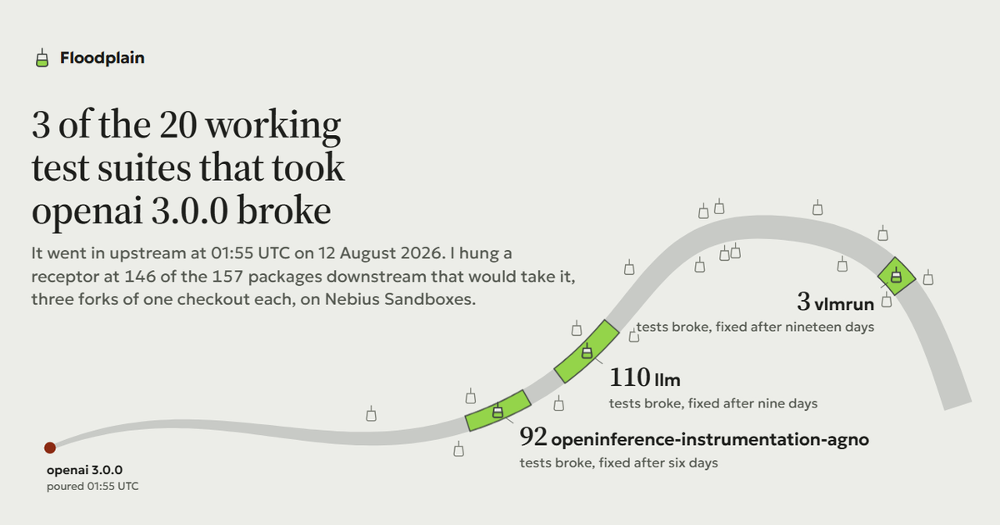

# Floodplain

Run the test suites of the packages that depend on yours, against your release, before your
users do. Every suite runs in forked Nebius Sandboxes; NVIDIA Nemotron reads what broke and
drafts a patch that the broken package's own test suite has to pass.

**Results page:** https://jonathansolvesproblems.github.io/floodplain/



## Why

At 01:55 UTC on 12 August 2026, `openai` 3.0.0 went up on PyPI. It swapped its HTTP client
from `httpx` to `httpx2` and stopped installing `httpx`. Six hours later a user opened
[llm #1608](https://github.com/simonw/llm/issues/1608): fresh installs of Simon Willison's `llm`
were broken and its test suite was escaping its mocks to call the live API. Simon's fix, a pin
below 3, shipped in llm 0.32.1 <!-- claim:fix_hours.llm -->231.3 hours after the release.

OpenAI could not have seen this coming from their own test suite. The evidence lived in other
people's repositories. Floodplain goes and runs them.

## What it found

I took every package in the top 15,000 on PyPI that declared `openai` as a dependency on
release day: <!-- claim:total_dependents -->220. Of those, <!-- claim:protected -->63 pinned
below 3.0.0 and were never exposed. I ran the other <!-- claim:exposed -->157 wherever a source
checkout could be found, <!-- claim:ran -->146 in all, three forks each.

<!-- claim:readable -->31 of them had a test suite that worked before the release.
<!-- claim:broken -->3 broke:

| package | what broke | what its maintainers later shipped |
|---|---|---|
| `llm` 0.32 | <!-- claim:broke.llm -->110 of <!-- claim:passed_before.llm -->1,069 passing tests | `openai>=2.32.0,<3` in [0.32.1](https://github.com/simonw/llm/releases/tag/0.32.1), <!-- claim:fix_hours.llm -->231.3 hours later |
| `openinference-instrumentation-agno` | all <!-- claim:broke.openinference-instrumentation-agno -->92 passing tests, lost to import errors | [Arize PR #3574](https://github.com/Arize-ai/openinference/pull/3574), routing the SDK through legacy `httpx`, <!-- claim:fix_hours.openinference-instrumentation-agno -->146.8 hours later |
| `vlmrun` | <!-- claim:broke.vlmrun -->3 of <!-- claim:passed_before.vlmrun -->231, all in `test_gateway.py` | [PR #215](https://github.com/vlm-run/vlmrun-python-sdk/pull/215) pinned `openai==1.109.1`, <!-- claim:fix_hours.vlmrun -->457.9 hours later, without saying why |

The other <!-- claim:status.ok -->28 read clean: every test that passed before still passed
after. Each of the three breaks was later confirmed by its own maintainers' action, recorded
with links in [maintainer_fixes.json](data/openai-3.0.0/maintainer_fixes.json).

### The patches

For each break, Nemotron drafted a patch and the package's own suite judged it in a fresh fork.
Nemotron samples differently every run, so one verified patch is a sample, not a behaviour. I
ran the whole fix loop five times per package and report how many came back verified:

| package | verified | what the verified patches did |
|---|---|---|
| `llm` | <!-- claim:fix_k.llm.r1-local-fallback -->5 of <!-- claim:fix_n.llm.r1-local-fallback -->5 | four pinned `openai>=2.32.0,<3.0.0`, the constraint Simon shipped in 0.32.1; one migrated instead, passing an explicit `httpx` client to the SDK so the mocks fire again |
| `openinference-instrumentation-agno` | <!-- claim:fix_k.openinference-instrumentation-agno.r1-local-fallback -->5 of <!-- claim:fix_n.openinference-instrumentation-agno.r1-local-fallback -->5 | an upper pin on `httpx` in the test dependencies |
| `vlmrun` | <!-- claim:fix_k.vlmrun.r1-local-fallback -->2 of <!-- claim:fix_n.vlmrun.r1-local-fallback -->5 | declared `httpx` explicitly, which 3.0.0 no longer brings in |

The three vlmrun failures were my fixer's fault, not the model's diagnosis: it showed Nemotron
only the first 120 lines of each file, and vlmrun imports `httpx` further down, so its edit
could not be applied. The fixer now shows every match in context. Trials from the two fixer
revisions are recorded separately and never pooled.

## How it works

**Three forks of one checkout.** For each dependent, one Nebius Sandbox clones the source at the
released version and persists that image. Three forks start from it at once, each installing
the package and its test dependencies with `uv` and the index frozen at a different moment:

| fork | dependency world | purpose |
|---|---|---|
| before | one minute before the release | the baseline |
| control | one minute before, again | catches flaky tests |
| after | one minute after the release | what a new user got |

A test that passes in `before`, fails in `after`, and agrees with itself between `before` and
`control` was broken by the release. A test that disagrees with itself across the two identical
forks is flaky and is thrown out.

**Pre-release mode.** `--candidate path/to/wheel` replaces the after fork's release with a wheel
you have not published. The wheel is offered to the resolver as the newest version, so a fresh
install gets it with exactly the dependencies it declares, and a package pinned below it keeps
the old version, as it would on release day.

**Triage.** Nemotron 3 Nano reads the failing log and names the cause, with evidence quotes.
Every quote is checked verbatim against the log; one it invented is dropped and counted, not
shown as evidence.

**Fix.** Nemotron 3 Super, then Ultra, proposes search-and-replace edits. Each is applied in a
further fork of the after image, the full install recipe is replayed (extras and dependency
groups included, so a pin in a test extra actually takes effect), and the suite runs. A patch
counts as verified only if pytest runs to completion, nothing fails to collect, and every test
that passed before the release passes again. A rejected strategy is named back to the model so
it tries a different one.

**Research.** Tavily searches for the upstream's migration guidance and extracts the relevant
pages in full. Two guards stop it handing Nemotron the answer: it only sees pages dated before
the day that package's maintainers acted, and any page from the package's own repository, or
naming it, is dropped and recorded. Without them, the top result for openai 3.0.0 was llm's own
issue, where the fix is discussed. Every response is committed under
[data/openai-3.0.0/research/](data/openai-3.0.0/research/), so a rerun replays exactly what the
original run saw and needs no Tavily key.

## The other 115

Most dependents could not give a reading, and the page says why for each one rather than
counting them as passes:

| reading | count | meaning |
|---|---|---|
| no baseline | <!-- claim:status.no-baseline -->54 | nothing passed before the release either: the suite needs services, credentials or system packages a sandbox does not have |
| no tests | <!-- claim:status.no-tests -->28 | no test suite ships at the released version |
| incomplete | <!-- claim:status.incomplete -->20 | a fork returned no results (timeout or transport failure) |
| unrunnable | <!-- claim:status.unrunnable -->13 | the package would not install, before or after the release |

## Checks that stopped a false result

Each of these would have published something untrue, and each was caught by a number that did
not add up:

1. A fork that returned nothing was reported as "nothing broke". Now `incomplete`.
2. "Broken" and "ok" verdicts were given against a before fork with zero passing tests. Now
   `no baseline`; [rescore.py](scripts/rescore.py) re-derives every stored verdict when a rule
   changes, without re-running anything.
3. A patch that fixed nothing in a suite that could not import came back "verified": the
   still-failing check skipped collection errors. Caught because pytest exited 2.
4. Verification reinstalled only the base package, so a pin in a test extra never took effect
   and the right agno fix was rejected 20 times out of 20.
5. In a monorepo, the fixer showed the model the repository root, and agno got patches aimed at
   the monorepo's Makefile.
6. Tavily's top result for openai 3.0.0 was llm's own issue, which discusses the fix.
7. The first pre-release mode installed the wheel over an environment already resolved with the
   old release. That kept `httpx` installed, which hid exactly the breaks agno and vlmrun had.

## Run it

Requires Python 3.12 and [uv](https://docs.astral.sh/uv/). Copy `.env.example` to `.env`, or
export the variables: a Nebius Token Factory API key and project id (inference and Sandboxes
both use them), and optionally a Tavily key.

```sh
uv sync --extra dev
uv run python -m pytest                     # unit tests, no keys needed
uv run python scripts/smoke.py              # one fork round trip on Nebius Sandboxes

# who depended on the release, and who was exposed to it
uv run python scripts/discover.py   --target openai --release 3.0.0 --scan 15000
uv run python scripts/population.py --target openai --release 3.0.0

# three forks per dependent, then triage and five fix trials for each break
uv run python scripts/run_experiments.py --target openai --release 3.0.0 --stage run
uv run python scripts/run_experiments.py --target openai --release 3.0.0 --stage fix --trials 5

# the same check against a wheel you have not published
uv run python scripts/run_experiments.py --target openai --release 3.0.0 --stage run \
  --candidate dist/openai-3.0.0-py3-none-any.whl --as-of 2026-08-12T01:54:48Z

# rebuild the page and confirm every figure in this README against the data
uv run python scripts/stats.py      --target openai --release 3.0.0
uv run python scripts/build_site.py --target openai --release 3.0.0
uv run python scripts/check_claims.py
```

Every figure in this README carries a hidden tag, and `check_claims.py` fails if any of them
disagrees with [stats.json](data/openai-3.0.0/stats.json).

## Built with

- **Nebius Token Factory Sandboxes** for every fork: content-addressed images, so one checkout
  becomes three identical starting points and each patch is tested in a further fork.
- **NVIDIA Nemotron 3** on Token Factory: Nano for triage, Super and Ultra for patches.
- **Tavily** search and extract for migration guidance, behind the guards above.

## Limits

- Only Python packages with a pytest suite that runs without outside services can give a
  reading; 31 of 146 did here.
- The replay freezes the index by PyPI upload time, so it reproduces what a fresh install
  resolved on release day, not what any one user's lockfile held.
- One release so far. The method is not specific to openai, but I have only measured it there.

## Licence

MIT. Built by Jonathan Andrei for the Nebius x NVIDIA Global AI Hackathon.
